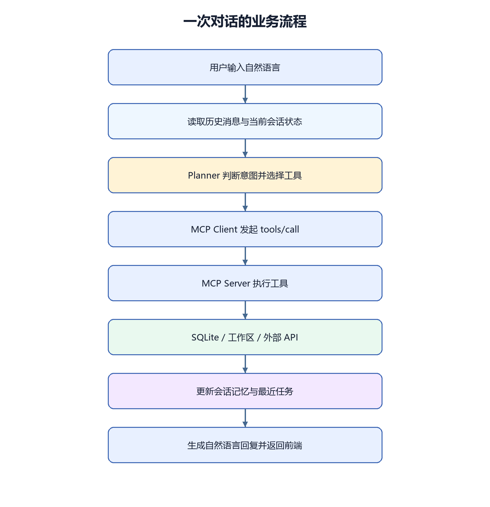
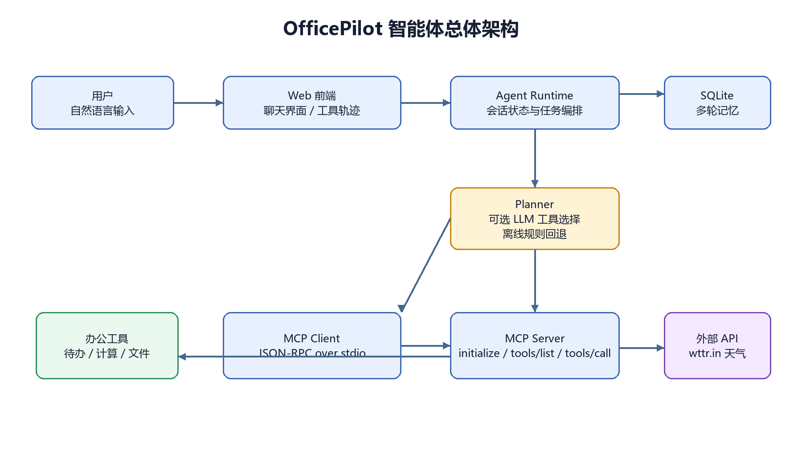
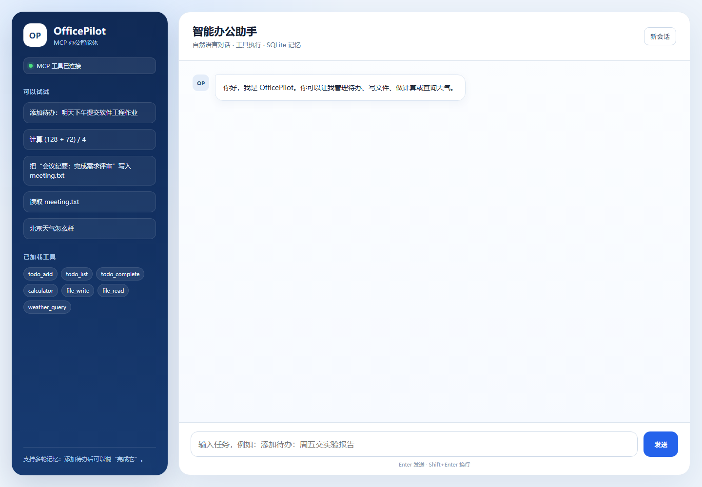
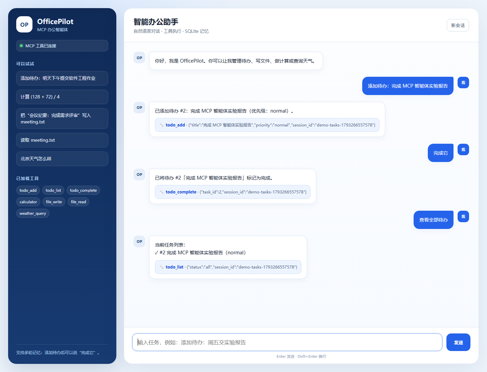
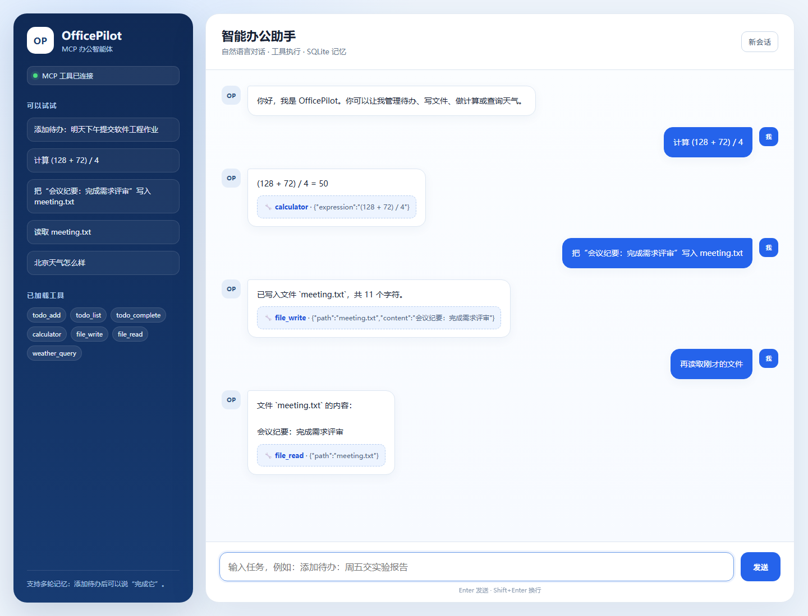
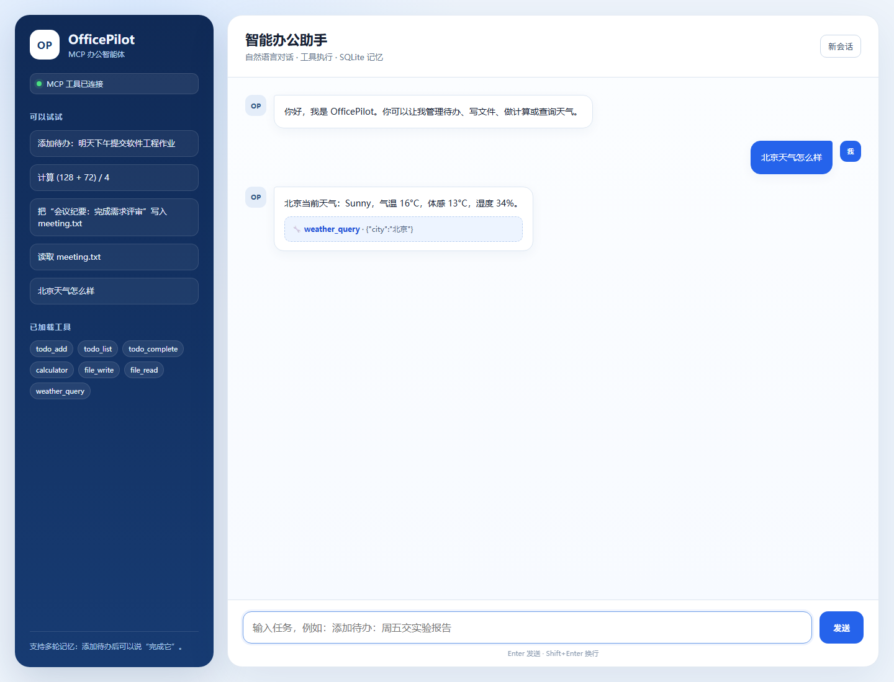

# 第二次团队作业：OfficePilot MCP 办公智能体

| 这个作业属于哪个课程 | [Class78-Grade2024-CS](https://edu.cnblogs.com/campus/gdgy/Class78-Grade2024-CS/) |
| --- | --- |
| 这个作业要求在哪里 | [作业要求](https://edu.cnblogs.com/campus/gdgy/Class78-Grade2024-CS/homework/16761) |
| 这个作业的目标 | 使用 MCP 风格工具构建一个能理解自然语言、能规划任务并调用工具完成办公操作的智能体 |
| 学号 | 3124004450 |

姓名：曾堉源  
GitHub 项目地址：[https://github.com/ZYY190/OfficePilot-Agent](https://github.com/ZYY190/OfficePilot-Agent)

## 一、需求描述

### 1.1 场景

这次作业中，我选择“AI 办公助理”作为智能体场景。用户经常需要在同一条工作流里完成多种动作，例如记录待办、计算数字、保存会议纪要、读取文件内容、查询天气。如果每个动作都要切换到不同应用，操作会变得零碎。

OfficePilot 的目标是让用户只输入一句话，由智能体理解意图、选择工具、执行操作，再用自然语言反馈结果。它需要同时具备两种能力：

- **能说**：支持自然语言聊天，能够解释自己的执行结果；
- **会做**：能够调用文件、数据库、计算和外部 API 等工具完成实际操作。

### 1.2 功能需求

| 编号 | 需求 | 验收方式 |
| --- | --- | --- |
| F1 | 自然语言对话 | 输入问候或普通问题，返回自然语言回复 |
| F2 | 待办管理 | 可以说“添加待办”“查看待办”“完成它” |
| F3 | 安全计算 | 输入四则表达式，返回正确结果 |
| F4 | 文件读写 | 在沙箱目录创建、追加、读取文本文件 |
| F5 | 天气查询 | 输入城市，调用外部天气接口并生成摘要 |
| F6 | 多轮记忆 | 上一轮创建文件和任务后，下一轮可用“它”指代 |
| F7 | 工具调用可视化 | 前端展示每次调用的工具名和参数 |
| F8 | MCP 兼容接口 | 支持 `initialize`、`tools/list`、`tools/call` |

### 1.3 非功能需求

- **可解释**：每次执行工具时保留工具名、参数和结果，前端可查看调用轨迹。
- **安全性**：文件工具只允许访问 `workspace` 沙箱，拒绝路径穿越；计算器只允许数字和四则运算符。
- **可移植**：只使用 Python 标准库，不依赖数据库服务器或第三方 Web 框架。
- **可降级**：没有配置大模型 API 时，仍能使用确定性的自然语言规则完成演示。

## 二、业务流描述



一次对话的业务流程如下：

1. 用户在网页输入自然语言任务。
2. Agent Runtime 读取当前会话的历史消息和状态。
3. Planner 判断任务意图，选择待办、计算、文件或天气工具。
4. MCP Client 将工具调用打包为 JSON-RPC 请求，通过标准输入发送给 MCP Server。
5. MCP Server 执行工具，并将统一格式的结果返回给 Agent Runtime。
6. Runtime 生成自然语言回复，同时把本轮消息和最新任务/文件写入 SQLite。
7. 前端显示回复、工具名、参数和执行结果。

例如用户先说“添加待办：完成实验报告”，下一轮只说“完成它”。Runtime 从会话状态中读取 `last_task_id`，Planner 将其解析为 `todo_complete`，因此不需要用户重复任务编号。

## 三、实现说明

### 3.1 总体架构



项目采用“前端 → Agent Runtime → MCP Client → MCP Server → 工具”的分层结构：

| 模块 | 主要职责 |
| --- | --- |
| `web/` | 单页聊天界面，展示消息和工具调用轨迹 |
| `agent/runtime.py` | 编排 Planner、MCP Client、SQLite 记忆和回复生成 |
| `agent/router.py` | 自然语言意图识别与离线规则回退 |
| `agent/llm_planner.py` | 可选的大模型工具选择适配器 |
| `agent/memory.py` | 消息、任务和会话状态的 SQLite 持久化 |
| `agent/mcp_client.py` | 启动 MCP Server 并通过 stdio 发送 JSON-RPC |
| `mcp_server/server.py` | 实现 MCP 初始化、工具列表和工具调用 |
| `mcp_server/tools.py` | 待办、计算、文件、天气工具集合 |

### 3.2 Agent 主循环

Agent 的核心循环可以概括为：

```text
读取上下文 → 理解意图 → 选择工具 → 通过 MCP 执行 → 更新记忆 → 生成回复
```

在没有配置模型 API 时，系统使用 `IntentRouter` 完成确定性规划；配置 `LLM_API_URL`、`LLM_API_KEY` 和 `LLM_MODEL` 后，会优先把对话历史和 MCP 工具定义交给兼容 Chat Completions 的模型进行工具选择，失败时自动回退到规则规划。这样既保留了真实模型接入能力，也保证课堂演示不依赖网络和密钥。

关键规划代码：

```python
if any(word in text for word in ["查看", "列出", "显示", "有哪些"]) and any(
    word in text for word in ["待办", "任务"]
):
    return Plan("tool", "todo_list", {"status": "all"})

complete = re.search(r"完成.{0,8}?(?:第\s*)?(\d+)\s*(?:个|项)?\s*(?:待办|任务)?", text)
if complete:
    return Plan("tool", "todo_complete", {"task_id": int(complete.group(1))})
```

### 3.3 MCP 工具协议

MCP Server 使用标准输入输出传输 JSON-RPC 消息。初始化请求示例：

```json
{"jsonrpc":"2.0","id":1,"method":"initialize","params":{"protocolVersion":"2024-11-05","capabilities":{},"clientInfo":{"name":"officepilot-agent"}}}
```

工具调用示例：

```json
{"jsonrpc":"2.0","id":3,"method":"tools/call","params":{"name":"todo_add","arguments":{"session_id":"demo","title":"完成实验报告"}}}
```

当前注册了 7 个工具：`todo_add`、`todo_list`、`todo_complete`、`calculator`、`file_write`、`file_read`、`weather_query`。Agent 不直接修改数据库或文件，而是通过统一工具接口完成操作，便于扩展和审计。

### 3.4 多轮记忆

SQLite 中设计了三张表：

| 表 | 作用 |
| --- | --- |
| `messages` | 按会话保存用户和助手消息 |
| `tasks` | 保存待办标题、优先级、状态和完成时间 |
| `session_state` | 保存最近任务编号和最近文件路径 |

因此“完成它”“读取刚才的文件”这类省略表达可以依赖会话状态解析，而不是要求用户重复完整信息。

### 3.5 工具安全

文件写入与读取都经过 `_safe_path` 校验：

```python
def _safe_path(raw_path: str) -> Path:
    candidate = (WORKSPACE_DIR / raw_path).resolve()
    if candidate != WORKSPACE_DIR and WORKSPACE_DIR not in candidate.parents:
        raise ValueError("只允许访问智能体工作区内的文件")
    return candidate
```

如果模型或用户传入 `../secret.txt`，工具会拒绝执行。计算器使用 `ast` 解析表达式，只允许数字、括号和四则运算节点，不执行 `eval`。

## 四、使用示例

### 4.1 启动方式

```powershell
.\start_web.ps1
```

浏览器打开 <http://127.0.0.1:8765>。也可以使用命令行：

```powershell
python -m agent.cli "添加待办：明天提交实验报告"
```

### 4.2 网页界面与实际使用截图

OfficePilot 的主界面包含聊天区、工具调用轨迹和示例任务入口。下面是初始界面：



#### 待办与多轮记忆

先添加待办，再输入“完成它”。智能体从 SQLite 会话状态中读取最近任务编号，无需用户重复说明：



#### 计算与文件读写

用户先计算表达式，再写入会议纪要文件，最后通过“刚才的文件”引用上一轮路径：



#### 外部天气 API

输入“北京天气怎么样”后，智能体调用 `weather_query` 工具访问 wttr.in，并将天气结果转换为自然语言：



### 4.3 功能演示

| 用户输入 | 智能体动作 | 实际回复 |
| --- | --- | --- |
| `添加待办：完成 MCP 智能体实验报告` | 调用 `todo_add`，写入 SQLite | 已添加待办 #1：完成 MCP 智能体实验报告（优先级：normal）。 |
| `完成它` | 从会话状态读取最近任务，调用 `todo_complete` | 已将待办 #1「完成 MCP 智能体实验报告」标记为完成。 |
| `计算 (128 + 72) / 4` | 调用 `calculator` | `(128 + 72) / 4 = 50` |
| `把“会议纪要：完成需求评审”写入 meeting.txt` | 调用 `file_write`，写入沙箱文件 | 已写入文件 `meeting.txt`，共 11 个字符。 |
| `再读取刚才的文件` | 从上下文读取路径，调用 `file_read` | 文件内容为“会议纪要：完成需求评审” |
| `北京天气怎么样` | 调用 `weather_query` 访问 wttr.in | 北京当前天气：Sunny，气温 18°C，体感 11°C，湿度 12%。 |

通过 `GET /api/health` 可以看到 MCP 工具已成功加载：

```json
{"ok": true, "tools": 7}
```

## 五、测试结果

执行命令：

```powershell
.\run_tests.ps1
```

测试结果：

```text
test_calculator ... ok
test_file_follow_up_memory ... ok
test_file_sandbox_and_round_trip ... ok
test_multi_turn_task_completion ... ok
test_tool_registry ... ok

Ran 5 tests in 0.253s
OK
```

测试覆盖工具注册、计算器、文件沙箱和路径穿越拦截、多轮任务完成、最近文件上下文。网页接口还通过真实 HTTP 请求验证了待办、计算、文件读写和天气查询。

## 六、加分项完成情况

| 加分项 | 完成情况 |
| --- | --- |
| 多轮对话记忆 | 已实现，使用 SQLite 保存消息、任务和最近文件状态 |
| 语音输入/输出 | 未实现，作为后续扩展 |
| 外部 API 或数据库 | 已实现 SQLite 和 wttr.in 天气 API |
| 简洁前端界面 | 已实现无依赖单页聊天界面 |

## 七、小组分工

| 成员 | 学号 | 主要工作 |
| --- | --- | --- |
| 曾堉源 | 3124004450 | 需求分析、Agent Runtime、MCP 工具实现、网页前端、测试与博客撰写 |

> 如果小组还有其他成员，请在提交前补充成员姓名、学号和实际分工。

## 八、个人心得

这次实现让我意识到，智能体真正困难的部分不是“让模型回答一句话”，而是把回答和行动之间的边界设计清楚。工具必须有明确的输入输出格式，执行结果必须可追踪，敏感操作必须受限制，否则智能体很容易变成不可控的自动化脚本。

我在实现 MCP Client 与 Server 的 stdio 通信时也遇到了 Windows 编码问题。子进程默认使用 GBK，导致 JSON 响应解码失败；最终通过强制设置 `PYTHONUTF8=1` 和 `PYTHONIOENCODING=utf-8` 解决。这个过程让我体会到，智能体的可靠性不仅来自模型，还来自进程通信、错误处理、状态持久化和边界校验。

后续可以继续加入语音输入、本地模型、日历接口和更细的任务依赖关系，让 OfficePilot 从演示型智能体逐步变成可以长期使用的办公助手。


